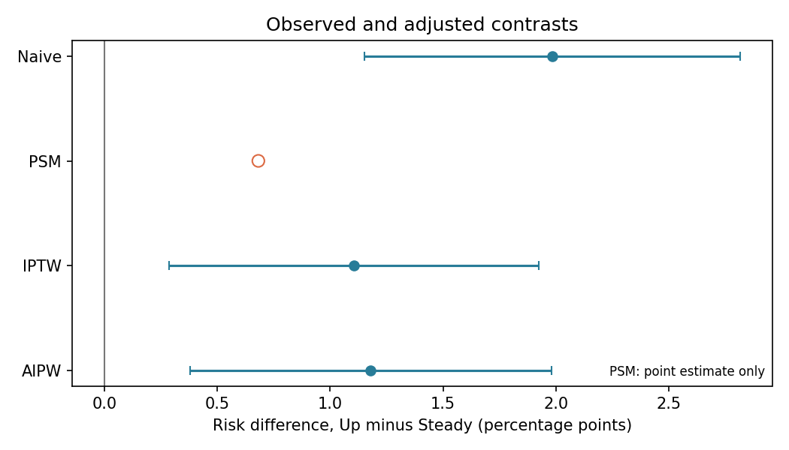

# Insulin Changes and 30-Day Readmission

**An observational follow-up to my [diabetes readmission prediction project](https://github.com/Dongwoon1d/diabetes-readmission-prediction).** Both projects use the UCI Diabetes 130-US Hospitals dataset and the same 30-day readmission outcome. The first asks *who is likely to be readmitted?* This project asks *how do observed readmission rates differ between encounters recorded with an insulin dose increase (`Up`) and those recorded as unchanged (`Steady`)?*

An important feature in a prediction model, including a SHAP explanation, does not establish what would happen if a clinician changed a patient's insulin dose. Here I compare the groups, adjust for measured characteristics, and examine where the data still fall short of a causal answer.

| | [Prediction project](https://github.com/Dongwoon1d/diabetes-readmission-prediction) | This companion analysis |
| --- | --- | --- |
| Question | Which patients have higher predicted readmission risk? | How do readmission rates compare for `Up` versus `Steady` insulin records? |
| Main methods | XGBoost, patient-level validation, leakage checks, SHAP | Crude comparison, propensity-score matching, IPTW, AIPW, balance diagnostics |
| Output | Prediction performance and model interpretation | Observed and measured-adjusted risk differences, with a design audit |

## Findings at a glance

Among **40,472 hospital encounters from 31,727 patients**, 30-day readmission occurred in **13.44%** of `Up` encounters and **11.46%** of `Steady` encounters. The crude difference was **+1.98 percentage points** (`Up` minus `Steady`). Adjustment for the available admission-time characteristics reduced the comparison. The adjusted methods produced estimates from **+0.68 to +1.18 percentage points**; they describe different target populations and should not be treated as interchangeable treatment effects.

| Comparison | Risk difference, percentage points | Approximate 95% interval |
| --- | ---: | ---: |
| Crude | +1.98 | +1.15 to +2.82 |
| Propensity-score matching (PSM) | +0.68 | Not reported |
| Inverse probability weighting (IPTW) | +1.11 | +0.29 to +1.92 |
| Augmented IPTW (AIPW) | +1.18 | +0.38 to +1.98 |



**Interpretation:** The dataset records whether an insulin dose increased during an encounter, but not *when* it increased or the patient's glucose and illness severity immediately before that decision. The cohort also excludes some discharge statuses determined after an in-hospital treatment decision. Measured-variable adjustment cannot resolve those issues. **These results are observational associations, not evidence that increasing insulin causes readmission.** The historical data are not a basis for clinical advice. See the [design and timing audit](docs/causal_design.md).

## Study design

| Component | Definition |
| --- | --- |
| Dataset | UCI Diabetes 130-US Hospitals, 1999–2008 |
| Unit | Hospital encounter; repeat encounters are grouped by patient for cross-fitting and clustered for reported intervals |
| Groups | `insulin = Up` versus `insulin = Steady`; the original data summarize changes during the encounter |
| Outcome | `readmitted = <30`, readmission within 30 days after discharge |
| Descriptive cohort | Recorded age band begins at 20 or older; excludes discharge codes 11, 13, 14, 19, 20, 21 for comparability with the prediction project |
| Measured adjustment | Age band midpoint; inpatient, emergency, and outpatient visits in the prior year; race, gender, admission type, and admission source |
| Methods | Crude risk difference; 1:1 PSM without replacement; stabilized IPTW; cross-fitted AIPW |
| Scale | Difference in readmission risk in percentage points, `Up` minus `Steady` |

PSM describes the **matched `Up` encounters**, whereas IPTW and AIPW produce ATE-like adjusted contrasts for the **eligible cohort**. Patient-grouped folds keep one patient's encounters out of the training data used to predict that patient's propensity and outcome risks. The estimated intervals for crude, IPTW, and AIPW use patient-cluster influence approximations. No interval is supplied for nearest-neighbor PSM. Full methods and caveats are documented in [docs/causal_design.md](docs/causal_design.md) and [results/analysis_summary.md](results/analysis_summary.md).

### What the diagnostics show

- 10,702 matched pairs; maximum absolute standardized mean difference (SMD) after matching: **0.026**.
- Maximum absolute SMD after IPTW: **0.082**. Balance of measured variables does not imply balance of unrecorded severity.
- The main propensity cap is 0.03–0.97; [clipping sensitivity](results/clipping_sensitivity.csv) reports 0.02 and 0.05 alternatives. The 0.03 cap was chosen after reviewing diagnostics, so these checks do not constitute a prespecified sensitivity analysis.
- The [score overlap](visuals/propensity_overlap.png), [covariate balance](visuals/covariate_balance.png), and [weight distribution](visuals/weight_distribution.png) plots make the adjustment inspectable.

## Reproduce the analysis

Use Python 3.10 or later. From the directory containing this README:

```bash
python -m venv .venv
source .venv/bin/activate
pip install -r requirements.txt
python run_analysis.py
```

On Windows, activate with `.venv\Scripts\activate`. The included dataset is `data/diabetic_data.csv`. To use another copy of the UCI CSV, run `python run_analysis.py --data /path/to/diabetic_data.csv`. The script regenerates `results/` and `visuals/`. To browse the output notebook, install JupyterLab with `pip install jupyterlab` and open `notebooks/01_read_results.ipynb` from the project root.

```text
data/            Source dataset and provenance
docs/            Design and variable-timing audit
src/             Cohort, adjustment, diagnostics, and plotting code
run_analysis.py  Reproducible entry point
results/         Saved tables, estimates, and diagnostic summary
visuals/         Saved figures shown in this README
notebooks/       Short guide to the generated results
```

For exact cohort counts, estimates, balance, and weighting checks, see [results/](results/). A stronger future study would require dose-decision timestamps, baseline glucose and severity, verified prior and discharge regimens, and follow-up that supports a clearly defined treatment comparison.

## Data source

Clore, J., Cios, K., DeShazo, J., & Strack, B. (2014). *Diabetes 130-US Hospitals for Years 1999–2008*. UCI Machine Learning Repository. [https://doi.org/10.24432/C5230J](https://doi.org/10.24432/C5230J). The data are distributed under CC BY 4.0; see [data/README.md](data/README.md).
