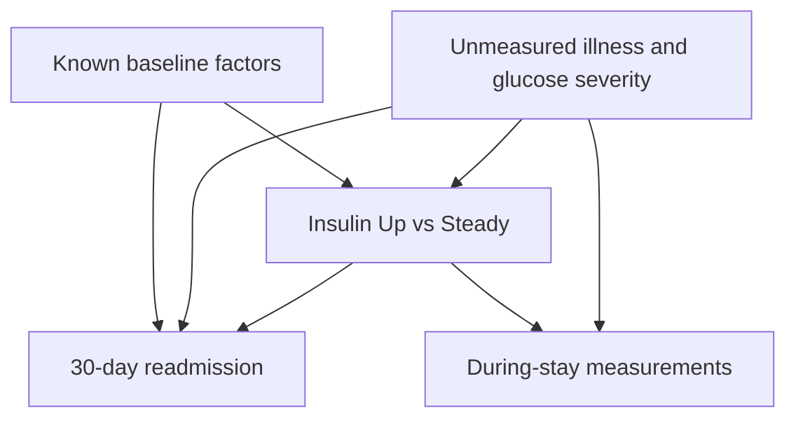

# Diabetes readmission: causal design audit

**Status:** provisional design, not an identified treatment effect  
**Dataset:** UCI Diabetes 130-US Hospitals (1999–2008), `diabetic_data.csv`  
**Source:** https://archive.ics.uci.edu/dataset/296/diabetes+130-us+hospitals+for+years+1999-2008

This is a companion to the [readmission prediction project](https://github.com/Dongwoon1d/diabetes-readmission-prediction). It shares the dataset and outcome but examines an observed insulin-group comparison. Predictive feature importance and SHAP values in the earlier project do not identify an insulin treatment effect.

## Question and preliminary cohort

Among encounters involving patients in recorded age bins **20–29 or older**, compare `insulin = Up` with `insulin = Steady` for readmission within 30 days after discharge (`readmitted = <30`). UCI describes `Up` as an insulin dose increase **during the encounter** and `Steady` as no insulin dose change during the encounter. These labels do not supply the date of the dose decision or the exact regimen at discharge.

For an initial descriptive comparison, follow the prediction project's discharge exclusions: `discharge_disposition_id` in 11, 13, 14, 19, 20, or 21. This cohort restriction occurs after an in-hospital treatment decision and may select on a treatment-related outcome. Reconsider it before giving any estimate a causal interpretation.

| Group | Encounter records | 30-day readmissions | Crude risk |
| --- | ---: | ---: | ---: |
| Insulin Up | 10,830 | 1,456 | 13.44% |
| Insulin Steady | 29,642 | 3,397 | 11.46% |

The crude risk difference is **+1.98 percentage points** (Up minus Steady). These 40,472 records belong to 31,727 patients; 8,745 records repeat a patient in this subset. Clustered inference must respect patient identity. The difference is descriptive, not an estimate of the effect of increasing insulin.

## Working DAG

`L` includes prior-year healthcare use, age, and conditions known at admission. `U` represents illness severity and pre-decision glucose status insufficiently captured here. The `T → Y` arrow is the causal effect being investigated, not a finding. Conditioning on `P` can bias that effect. Survival/discharge selection is an additional concern not represented by the compact diagram.

## Variable timing audit

| Columns | Timing from documentation | Initial decision |
| --- | --- | --- |
| `age`, `gender`, `race` | Pre-existing characteristics; race missing in 2.93% of this comparison cohort | Candidate baseline covariates; handle missing race explicitly |
| `number_inpatient`, `number_emergency`, `number_outpatient` | Visits in the year preceding the encounter | Candidate baseline utilization/severity proxies |
| `admission_type_id`, `admission_source_id` | Admission descriptors | Candidate baseline covariates if the dose decision follows admission |
| `diag_1`, `number_diagnoses` | Encounter diagnoses; recording time relative to dose increase is not established | Do not include in the primary model until timing is justified |
| `A1Cresult`, `max_glu_serum` | Tests recorded during the encounter; order relative to insulin change is unknown. `A1Cresult` is absent/not measured in 80.83% of this cohort | Do not treat as a measured pretreatment lab value |
| `time_in_hospital`, `num_lab_procedures`, `num_medications`, `num_procedures` | Whole-encounter totals | Exclude from baseline adjustment |
| `change`, `diabetesMed`, other medication-change columns | During-encounter treatment summaries. Every Up record has `change = Ch`; 14,374 Steady records also have `Ch` | Do not adjust for aggregate `change`; do not use it to define baseline |
| `discharge_disposition_id` | End-of-encounter disposition | Never a pretreatment confounder; separately evaluate selection into the readmission-eligible cohort |

**Observed indication imbalance:** Up patients averaged 0.83 prior inpatient visits and 0.36 prior emergency visits; Steady patients averaged 0.62 and 0.17, respectively. This supports concern about baseline differences but does not measure all confounding.

## Identification decision

The dataset contains no timestamp for insulin dose changes, no clearly pretreatment admission glucose measurement, and no verified baseline insulin dose or discharge regimen. Therefore the backdoor path through illness/glucose severity cannot be assumed closed. PSM, IPTW, and AIPW can adjust measured baseline differences, but agreement among them would not establish a clinical treatment effect.

**Implementation:** `run_analysis.py` builds the cohort, baseline table,
patient-grouped cross-fitting, matching, weighting, adjusted contrasts,
diagnostic figures, and specification checks. The reported estimates remain
adjusted observational associations unless a richer, time-stamped source
resolves the exposure timing and major severity confounding.
